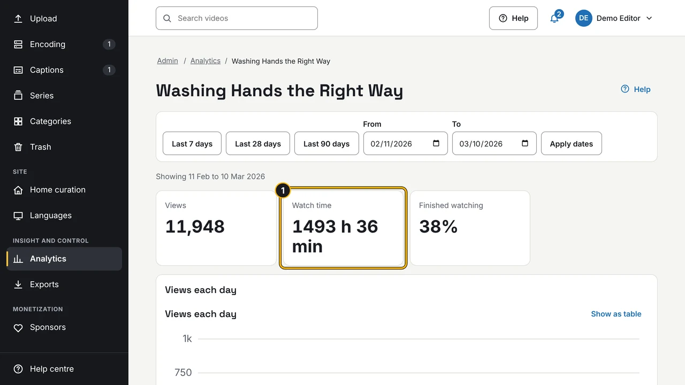
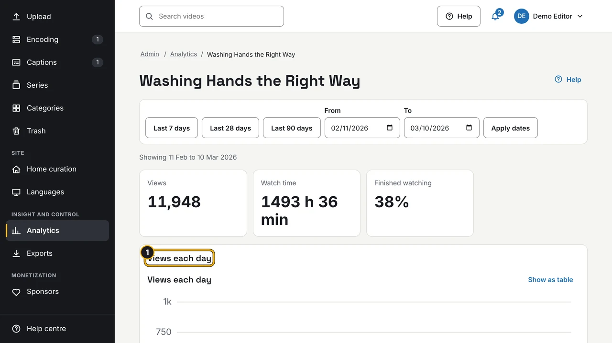
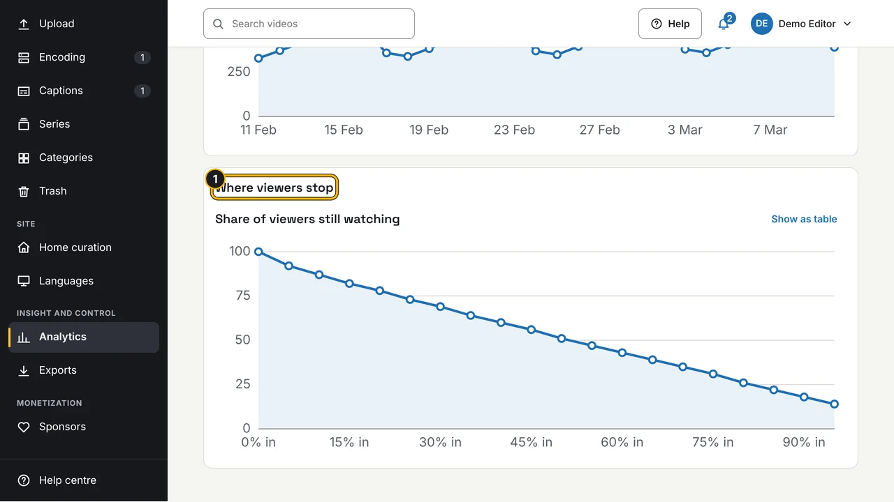

## What you will do
Look at one video on its own. You end knowing how many people watched it and at what point they stopped.

## Before you start
Editors, Admins and Super admins can do this. Read [Read Analytics](help:W10) first, so the tiles are familiar.

## Steps
<!-- kb:steps W11 -->
1. Choose **Analytics** in the side menu.
2. Click **Washing Hands the Right Way** in Top titles.
   Every title in the table opens its own page.
   
3. Check that the **Finished watching** tile shows a percent.
   A low number can mean the video is too long or the start is slow.
4. Scroll to **Views each day**.
   Look for a spike after you added the video to Home or a series.
   
5. Scroll to **Where viewers stop**.
   The line falls where people leave. A steep drop near the start suggests a slow intro.
   
6. Click **Last 90 days**.
   A longer range smooths out a quiet week.
<!-- /kb:steps -->

## What you should see
The video title as the page heading, three tiles (**Views**, **Watch time** and **Finished watching**), the **Views each day** line and the **Where viewers stop** line.

> [!NOTE]
> **Where viewers stop** shows the share of viewers still watching at each point of the video. It starts at 100% and falls. A steep fall near the start means many people leave early. A flat line means they stay.

> [!TIP]
> If most people stop in the first minute, shorten the intro or add skip intro. If the line falls near the end, that is normal, because people leave when the credits start.

## If something goes wrong
- **The page says "No views for this video in this period."** Choose a longer range, such as **Last 90 days**. A new video may not have been watched yet.
- **The chart says "Retention needs a few more views."** The video has too few views to draw a fair line. Check again next week.
- **The page says "We could not load analytics for this video."** Nothing was changed. Wait a minute and try again.
