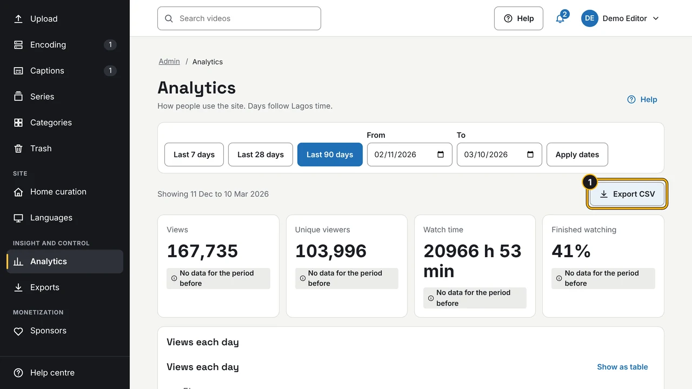
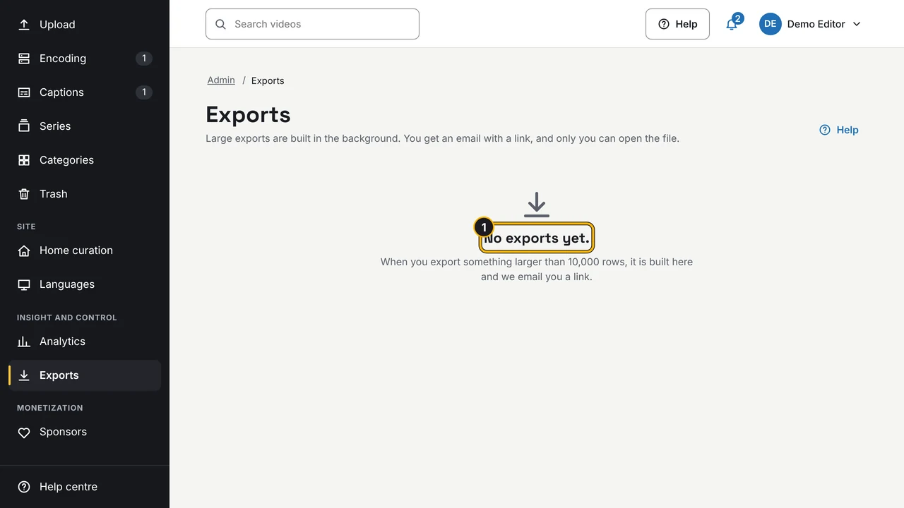

## What you will do
Download the analytics for a date range as a CSV file that opens in Excel or Google Sheets. You also learn where a very large report waits for you.

## Before you start
Editors, Admins and Super admins can export analytics. Only a Super admin can export the audit log, from the **Audit log** page. An export file may hold information about people, so keep it private and delete it when you are done.

## Steps
<!-- kb:steps W12 -->
1. Choose **Analytics** in the side menu.
2. Click **Last 90 days**.
   The report holds the dates you see on screen.
3. Click **Export CSV**.
   A small report downloads at once. A very large one is built in the background and emailed to you as a link.
   
4. Choose **Exports** in the side menu.
   Exports lists the large reports you asked for, newest first.
   
5. Check that **No exports yet.** is on the page.
   Once a large export is Ready, a Download link appears on its row and works for 3 days.
<!-- /kb:steps -->

## What you should see
A CSV file in your Downloads folder with one row for each day and title in the range you chose. On the **Exports** page you see **No exports yet.** until you ask for a large one.

> [!NOTE]
> There is no New export button. A report starts from the screen it belongs to: **Export CSV** on **Analytics**, or the export button on the **Audit log** (Super admin only).

> [!NOTE]
> A report with more than 10,000 rows is too big to download at once. You are shown a page that says it is too big, with **Build the file and email me**. Click it and we email you a link. The row then appears on **Exports** as **Waiting**, then **Building**, then **Ready**. Click **Download** on the row. The file stays for 3 days and only you can open it.

> [!CAREFUL]
> You can have only a few large exports waiting at once. If you see "You already have exports waiting", wait for one to finish.

## If something goes wrong
- **Nothing downloads.** Your browser may have blocked it. Allow downloads for this site, then click **Export CSV** again.
- **The row says Failed.** Read the reason under it, then ask for the report again with a shorter date range.
- **The link in the email has expired.** Files stay for 3 days. Ask for the report again.
