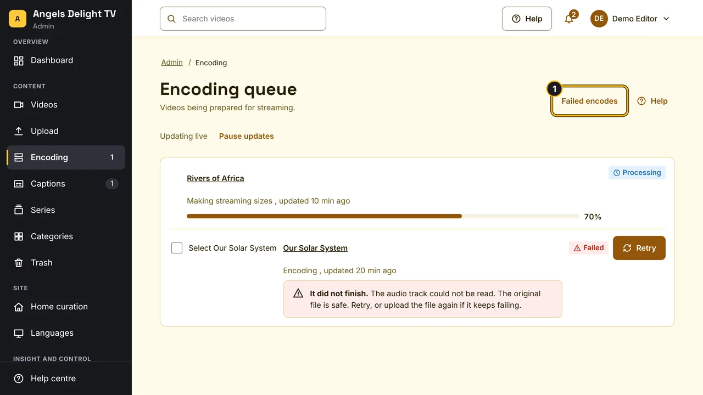
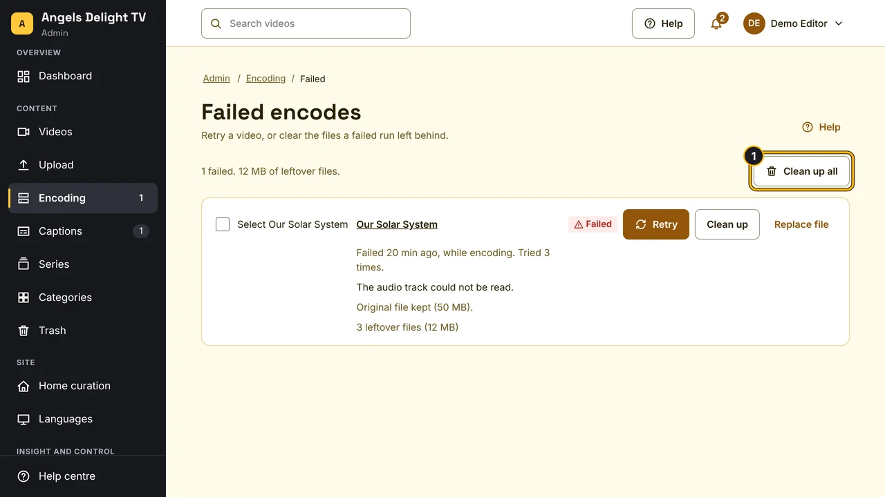
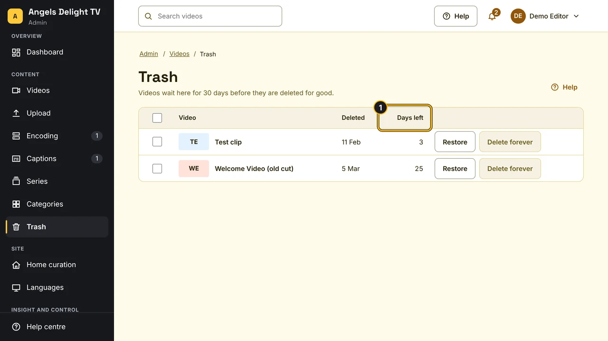
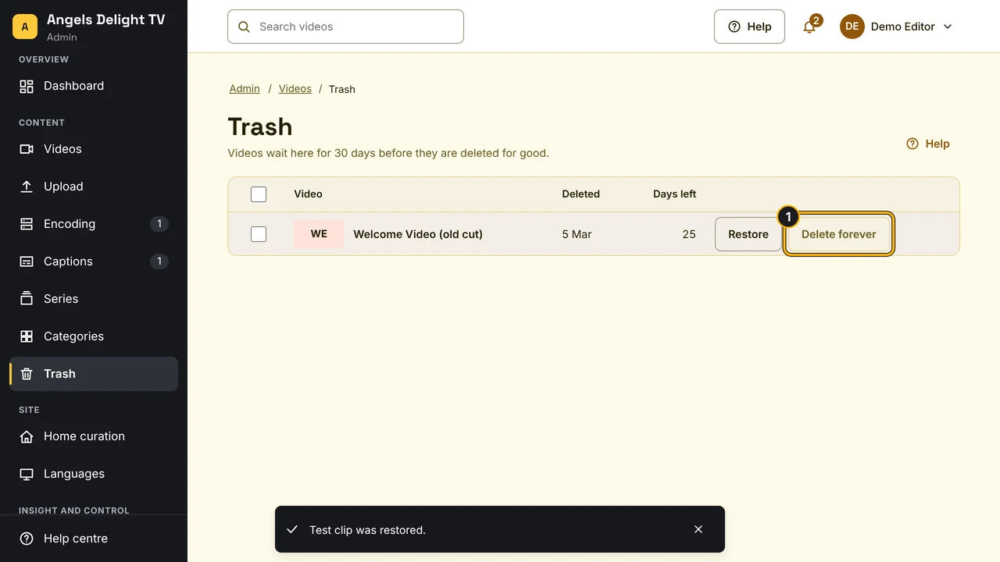

## What you will do
Look through [Trash](glossary:trash) once a week, bring back anything that was deleted by mistake, and clear the files that a failed [encoding](glossary:encoding) left behind.

## Before you start
Editors, Admins and Super admins can restore a video and clean up failed encodes. Only Admins and Super admins can choose **Delete forever**. If you are an Editor, that button is greyed out.

## Steps
<!-- kb:steps W13 -->
1. Click **Open in Encoding**.
   It is in Needs attention on the Dashboard. You can also open Encoding in the side menu.
   
2. Click **Failed encodes**.
   
3. Check that **Clean up all** is on the page.
   Clean up all deletes only the half made streaming files, never your original videos. It is greyed out when nothing is left over. Each row also has Retry or Replace file.
4. Choose **Trash** in the side menu.
   Videos wait here for 30 days before they are deleted for good.
   
5. Click **Restore Test clip**.
   A restored video comes back as a draft. Nothing is published until you choose Publish.
   
<!-- /kb:steps -->

## What you should see
The restored video is gone from **Trash** and is back in **Videos** as a draft. On **Failed encodes**, each failed video has its reason, with **Retry** or **Replace file**. After **Clean up all**, a message tells you how many files were removed and how much space was freed.

> [!NOTE]
> **Days left** counts down from 30. When it reaches 0, the video and its files are deleted for good. Restore anything you still want before then.

> [!CAREFUL]
> **Delete forever** cannot be undone. Use it only when you are sure, and only for a video you do not need.

> [!TIP]
> **Clean up all** does not delete your original video. It only deletes the half made streaming files, so a retry starts fresh and you get space back. In the practice site used for these pictures nothing is left over, so the button is greyed out.

## If something goes wrong
- **Clean up all is greyed out.** There are no leftover files to remove. You can still click **Retry** on a row.
- **A row says the original file was removed.** It cannot be retried. Upload the video again with **Replace file** on the row.
- **Restore did not work.** Nothing was changed. Try again, and if it fails again, send the reference code to the developer.
