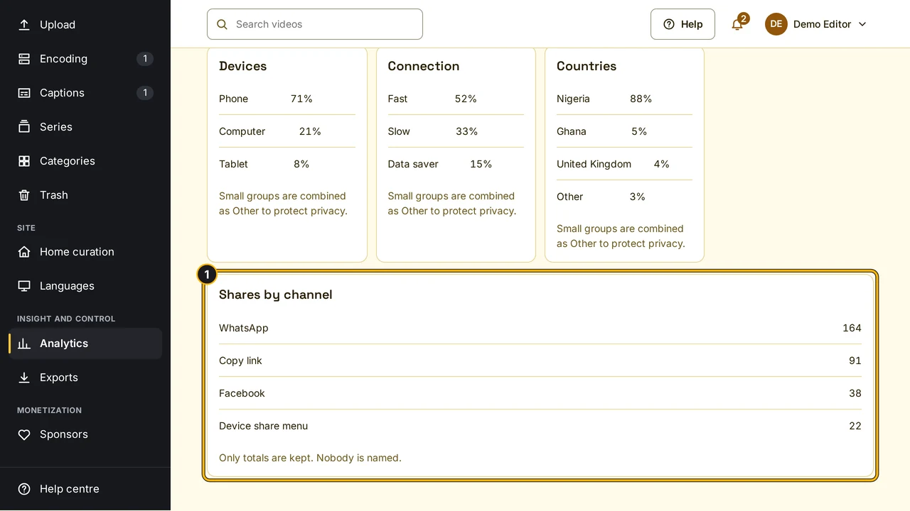
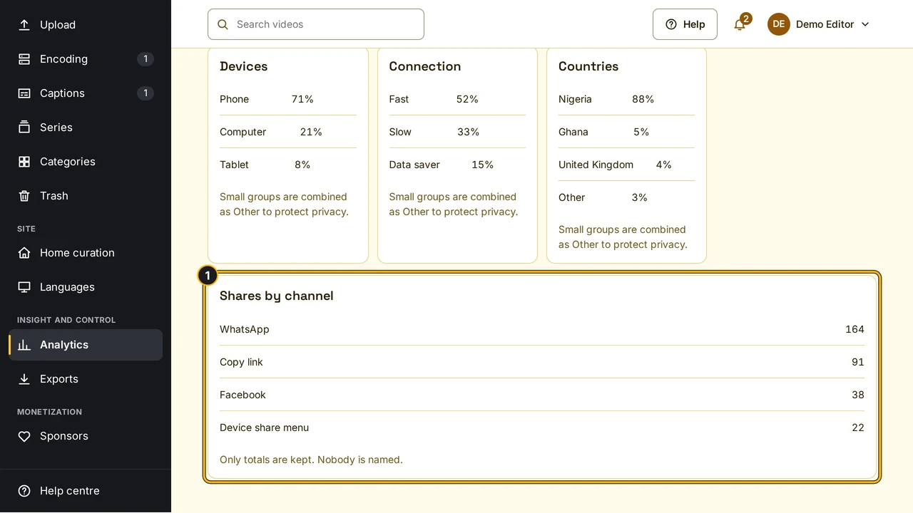

## What you will do
Find out how many times viewers shared the site, and how many times they shared one video. You end knowing which option they use most.

## Before you start
Editors, Admins and Super admins can do this. Read [Read Analytics](help:W10) first.

## Steps
<!-- kb:steps W15 -->
1. Choose **Analytics** in the side menu.
2. Scroll to **Shares by channel**.
   The list shows how many times viewers used each Share option in the period you chose.
   
3. Click **Washing Hands the Right Way** in Top titles.
4. Scroll to **Shares by channel**.
   On a title page the counts are for that title alone.
   
<!-- /kb:steps -->

## What you should see
A card called **Shares by channel**. It lists each share option with a number, such as **WhatsApp** and **Copy link**. The overview card counts every title. The card on a title page counts that title only.

> [!NOTE]
> A share is counted when a link was really copied, or a share option was chosen. A cancelled device menu, a failed copy and a tap while offline count nothing. Only totals are kept, so nobody is named, and visitors who send Do Not Track or Global Privacy Control are not counted.

> [!TIP]
> If one option never shows a count, move it higher in [Choose which share options show and their order](help:C16), or switch off the ones nobody uses.

## If something goes wrong
- **The card says "Nothing was shared in this period."** Choose a longer range at the top of the page. A new video may not have been shared yet.
- **The counts look low.** Viewers who share with the device menu show under **Device share menu**, and some people copy the address bar instead. [Read Analytics](help:W10) Still stuck? [What to send ARKDEV](help:T11)
