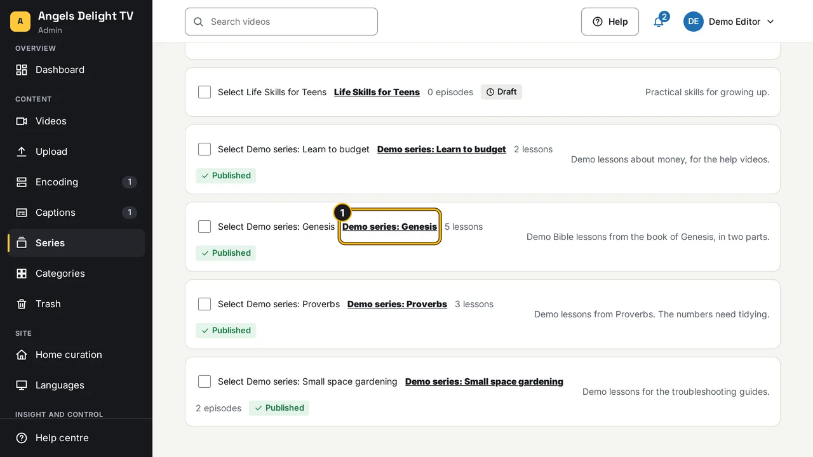
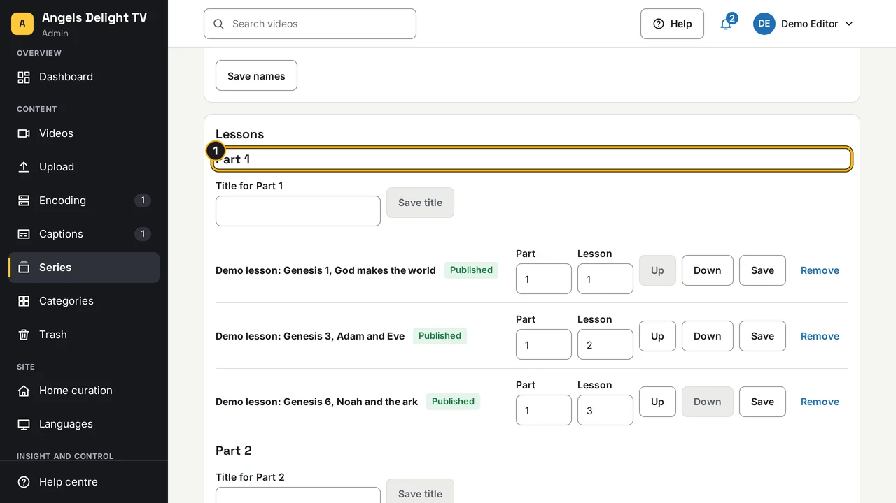

## What you will do
See how a [series](glossary:series) is built from groups and items. You end knowing how to plan your own, for example a Genesis series.

## Before you start
You need the Editor role or above. Read [Find your way around](help:S04) if the side menu is new to you.

Plan on paper first. A series has two levels:

- A [group](glossary:group) is a section, such as **Part 1**.
- An [item](glossary:item) is one video in a group, such as **Lesson 1**.

A Genesis plan might read Part 1 Beginnings (Lessons 1 to 3) and Part 2 The family of Abraham (Lessons 1 and 2). The words Part and Lesson are your choice. See [Choose the series names for your whole site](help:W21).

## Steps
<!-- kb:steps W20 -->
1. Choose **Series** in the side menu.
   
2. Click **Demo series: Genesis** in the list.
3. Scroll to **Part 1** to see the first group.
   
4. Scroll to **Part 2** to see the second group.
<!-- /kb:steps -->

## What you should see
The series page lists each group with its lessons in order. Each lesson shows its number and whether it is published.

## If something goes wrong
- **You see Season and Episode, not Part and Lesson.** Your site uses the default words. [Choose the series names for your whole site](help:W21)
- **A lesson is missing.** It may not be added yet. [Create a series and add episodes](help:W01) Still stuck? [What to send ARKDEV](help:T11)
