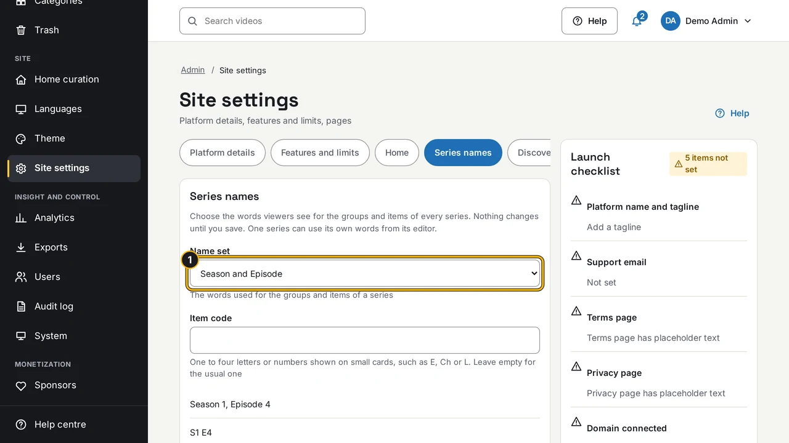
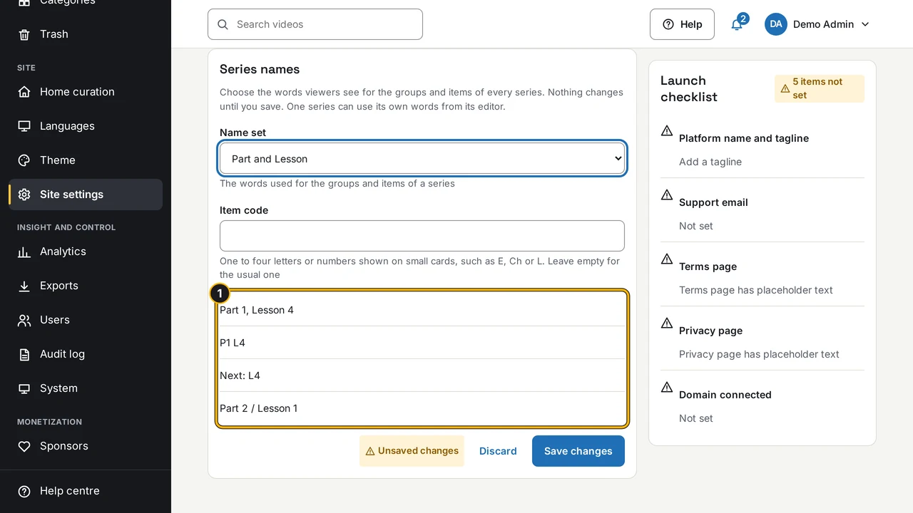

## What you will do
Choose the words viewers see for the groups and items of every series. You end with a [name set](glossary:name-set) such as Part and Lesson saved for the whole site.

## Before you start
You need the Admin role or above. Editors can read this guide but cannot save the setting. Read [Plan a series](help:W20) first.

Ready-made choices are Season and Episode, Book and Chapter, Part and Lesson, Module and Lesson. Choose **Custom names** to type your own four words, one and many for each of the group and the item.

The **Item code** is a short tag on small cards, such as Gen 4. Use one to four letters or numbers.

## Steps
<!-- kb:steps W21 -->
1. Choose **Site settings** in the side menu.
2. Click the **Series names** tab.
   
3. Select **Part and Lesson** from the **Name set** list.
   
4. Type "Gen" in the **Item code** box.
5. Click **Save changes**.
<!-- /kb:steps -->

## What you should see
A message says **Series names saved.** The preview list under the name set shows the new words, for example Part 1, Lesson 4. Series that do not have their own names now use these words.

> [!NOTE]
> Nothing changes for viewers until you save. A series with its own names keeps them. See [Use different names for one series](help:W22).

## If something goes wrong
- **Save changes does nothing.** A word may be too long or contain a dash. Fix the field marked in red and save again.
- **A series still shows the old words.** It has its own names. [Use different names for one series](help:W22) Still stuck? [What to send ARKDEV](help:T11)
