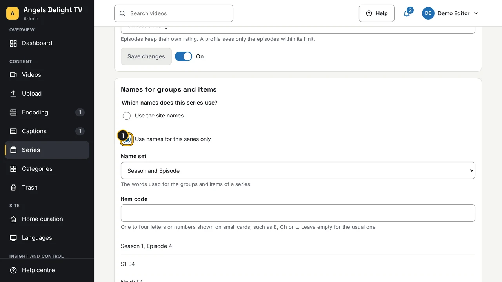

## What you will do
Let one series use different words from the rest of the site. You end with that series reading, for example, Module and Lesson while other series keep the site words.

## Before you start
You need the Editor role or above. Know the site words first: [Choose the series names for your whole site](help:W21).

## Steps
<!-- kb:steps W22 -->
1. Choose **Series** in the side menu.
2. Click **Maths Made Simple** in the list.
3. Scroll to **Names for groups and items**.
4. Click **Use names for this series only**.
   
5. Select **Module and Lesson** from the **Name set** list.
6. Click **Save names**.
<!-- /kb:steps -->

## What you should see
A message says **Series names saved.** The lists and buttons on this page use the new words. To go back, choose **Use the site names** and click **Save names**.

## If something goes wrong
- **The names do not save.** A custom word may be empty or too long. Fix the field marked in red.
- **Viewers still see the old words.** Reload their page. The change is saved on the series, not on single videos. Still stuck? [What to send ARKDEV](help:T11)
