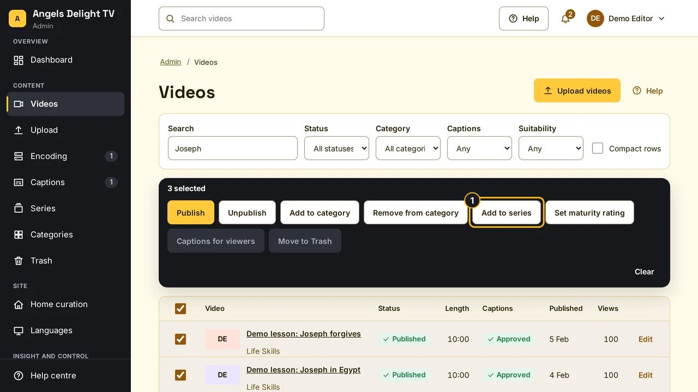
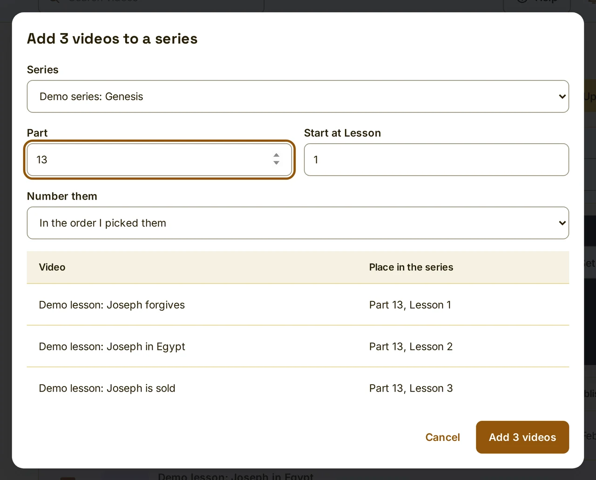

## What you will do
Put several videos into a series in one go. You end with each video numbered, for example Part 3, Lessons 1 to 3 of a Genesis series.

## Before you start
You need the Editor role or above. The videos must already be uploaded. You can add videos from the current page of the list only.

You can order the new numbers three ways: the order you picked, by title, or by upload date with the oldest first.

## Steps
<!-- kb:steps W23 -->
1. Choose **Videos** in the side menu.
2. Type "Joseph" in the **Search** box.
3. Wait until you see **Demo lesson: Joseph is sold** in the list.
4. Tick **Select all on this page**.
   
5. Click **Add to series** in the bar.
6. Select **Demo series: Genesis** from the **Series** list.
7. Type "3" in the **Part** box.
   
8. Click **Add 3 videos**.
9. Click **Undo** to take them out again.
<!-- /kb:steps -->

## What you should see
The preview table lists every video with its place, for example Part 3, Lesson 1. After you add them, a message offers **Undo** for a few seconds.

> [!TIP]
> Read the preview before you click **Add 3 videos**. A red message above it says what to fix, such as a number already taken.

> [!NOTE]
> The demo recording clicks **Undo** at the end so the demo stays the same. Do the same only if the numbers look wrong.

## If something goes wrong
- **Add to series is grey.** Select rows on this page first. It cannot work on every match of a search. Find videos and change many at once
- **A red message says a number is taken.** Choose another **Part** or start at a later lesson. [Fix gaps and duplicate numbers](help:W25)
