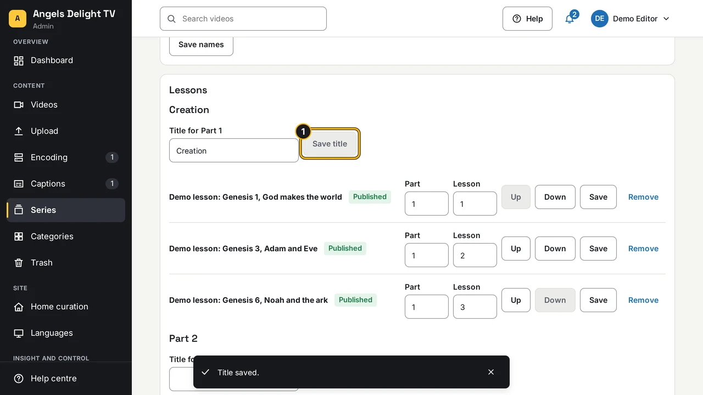

## What you will do
Rename a [group](glossary:group) and move one [item](glossary:item) into another group. You end with a group titled Creation and a lesson moved from Part 2 into Part 1.

## Before you start
You need the Editor role or above. Open a series with at least two groups, such as the Genesis demo series.

There is no one click move. You change the group number and the lesson number of the video, then save. Pick a lesson number that is free in the new group.

## Steps
<!-- kb:steps W24 -->
1. Choose **Series** in the side menu.
2. Click **Demo series: Genesis** in the list.
3. Type "Creation" in the **Title for Part 1** box.
4. Click **Save title for Part 1**.
   
5. Type "1" in the **Part** box.
6. Type "4" in the **Lesson** box.
7. Click **Save numbers for Demo lesson: Genesis 22, Abraham and Isaac**.
<!-- /kb:steps -->

## What you should see
A message says **Title saved.** and later **Numbers saved.** The moved lesson now appears under the other group, in its new place.

> [!TIP]
> A group with a title shows the title as its heading, for example Creation instead of Part 1. The number box still says Part.

## If something goes wrong
- **A warning says Check the numbers.** Two lessons share a number in the group. [Fix gaps and duplicate numbers](help:W25)
- **The title does not save.** It can be up to 60 characters. Shorten it and click the save button again. Still stuck? [What to send ARKDEV](help:T11)
