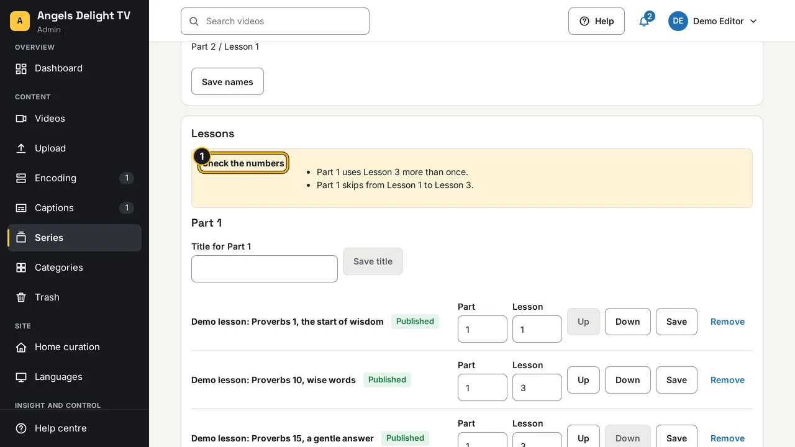

## What you will do
Find and fix a gap or a repeat in the lesson numbers. You end with numbers that run 1, 2, 3 with no warning.

## Before you start
You need the Editor role or above. The Proverbs demo series has a gap (no Lesson 2) and a repeat (two Lesson 3s).

The warning is called **Check the numbers**. It says which lesson is missing or repeated in which group.

## Steps
<!-- kb:steps W25 -->
1. Choose **Series** in the side menu.
2. Click **Demo series: Proverbs** in the list.
3. Check that **Check the numbers** warns about the problem.
   
4. Type "2" in the **Lesson** box.
5. Click **Save numbers for Demo lesson: Proverbs 15, a gentle answer**.
<!-- /kb:steps -->

## What you should see
A message says **Numbers saved.** The **Check the numbers** warning is gone.

> [!NOTE]
> Viewers can still watch a series with a gap. The warning helps you keep the order clear.

## If something goes wrong
- **The warning stays.** Another lesson still shares a number. Read the warning again and fix the next one.
- **You changed the wrong lesson.** Type its old number back and save again. [Reorder episodes and seasons](help:W02) Still stuck? [What to send ARKDEV](help:T11)
