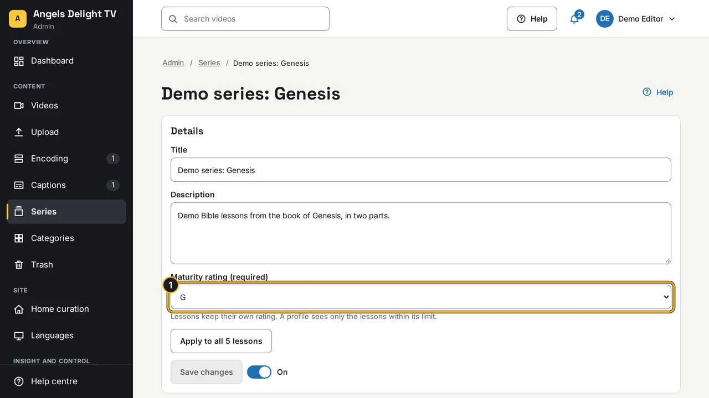
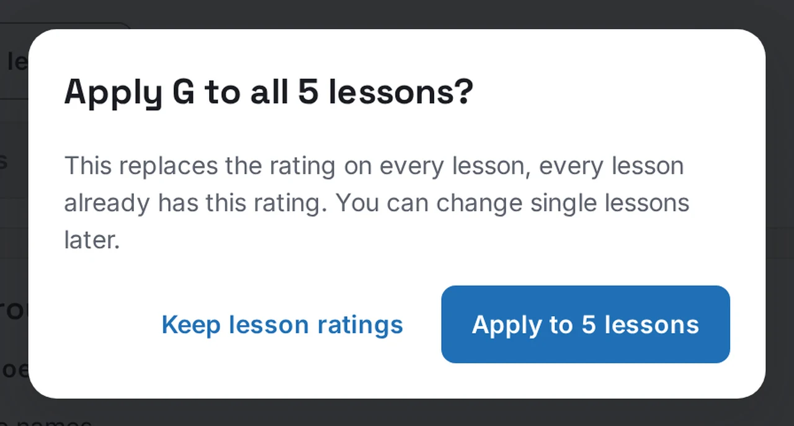

## What you will do
Set the maturity rating of a series and apply it to all its lessons. You end with one rating on every lesson.

## Before you start
You need the Editor role or above. A series must have a rating before it can be published.

The lessons keep their own rating until you apply the series rating. Applying replaces the rating on every lesson, so you can change single lessons afterwards.

## Steps
<!-- kb:steps W26 -->
1. Choose **Series** in the side menu.
2. Click **Demo series: Genesis** in the list.
3. Check that **Maturity rating (required)** shows a rating.
   
4. Click **Apply to all 5 lessons**.
   
5. Click **Apply to 5 lessons** to confirm.
<!-- /kb:steps -->

## What you should see
A message says **Rating applied to every lesson.** Every lesson in the series shows the same rating.

> [!CAREFUL]
> Applying replaces the rating of every lesson, including ones you set by hand. The box tells you how many differ today.

## If something goes wrong
- **The Apply button is missing.** Save the rating first. The button appears once the saved rating matches the list.
- **A lesson still shows another rating.** It may have been added after you applied. Apply again.
