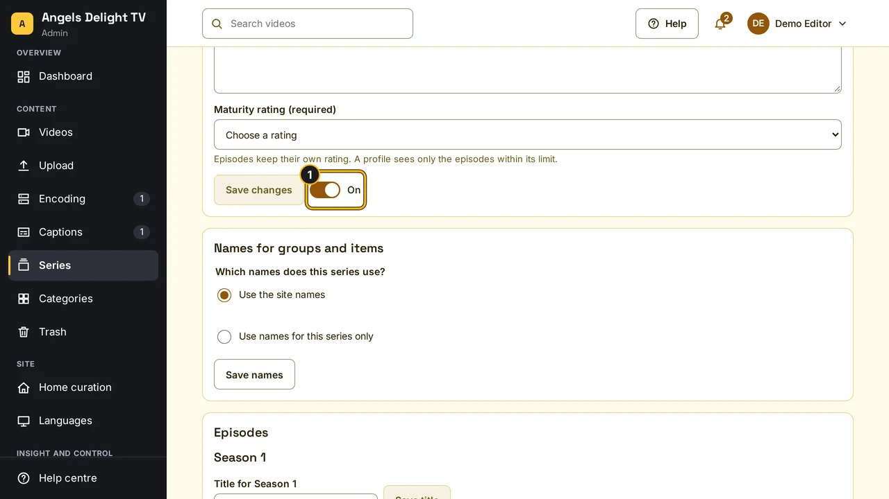

## What you will do
Look at a series the way a viewer sees it. You end knowing the Play button, the group list and where the series appears.

## Before you start
You need the Editor role or above. The series must be published to show on the site. Draft series are visible to staff only.

Viewers see a series page with a group list in your own words, such as Part, and the lessons below. The main button says **Play** the first time and **Resume** when a viewer has started. A small card on Home says what comes next, for example Next: Lesson 4. A series also appears in Home rows and in search results. On a phone the group list becomes a menu above the lessons.

## Steps
<!-- kb:steps W27 -->
1. Choose **Series** in the side menu.
2. Click **Maths Made Simple** in the list.
3. Check that **Published** is switched on.
   
<!-- /kb:steps -->

## What you should see
The series page shows its title, the Play button and the lessons in order.

The recording shows only the admin side, because the demo series are not on the viewer demo site. The viewer page is described above.

> [!NOTE]
> **Preview site** in the top bar opens the site in a new tab, so you can check the series page yourself.

## If something goes wrong
- **The series is not on the site.** It is probably a draft. Use the **Published** switch on the series page.
- **The words are Season and Episode.** The site words are not set. [Choose the series names for your whole site](help:W21)
