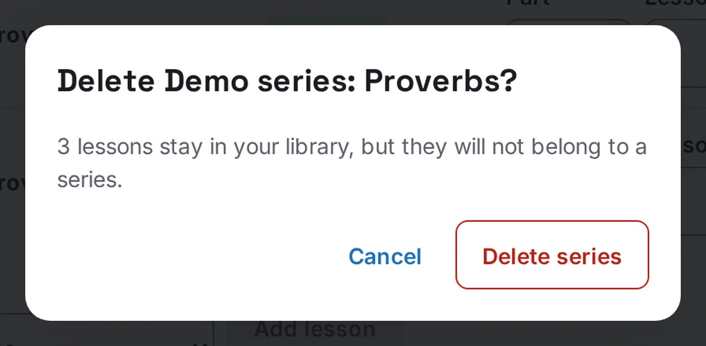

## What you will do
Delete a series and keep its videos. You end with the videos as single videos, ready to add to another series.

## Before you start
You need the Admin role or above. Editors can click **Remove** beside one lesson to take it out of a series.

The box says how many lessons stay in your library. The group titles and numbers are lost, so note them first if you may rebuild the series.

## Steps
<!-- kb:steps W28 -->
1. Choose **Series** in the side menu.
2. Click **Demo series: Proverbs** in the list.
3. Click **Delete series** at the bottom of the page.
   
4. Click **Delete series** in the box to confirm.
<!-- /kb:steps -->

## What you should see
A message says **Series deleted.** The Series list no longer shows it, and the videos still show in **Videos**.

> [!CAREFUL]
> Deleting a series cannot be undone. To rebuild it, create a new series and use Add many videos to a series.

## If something goes wrong
- **The Delete series button is grey.** Only Admins can delete. Ask an Admin, or remove lessons one by one.
- **You deleted the wrong series.** Create it again and add the videos back. Add many videos to a series Still stuck? [What to send ARKDEV](help:T11)
