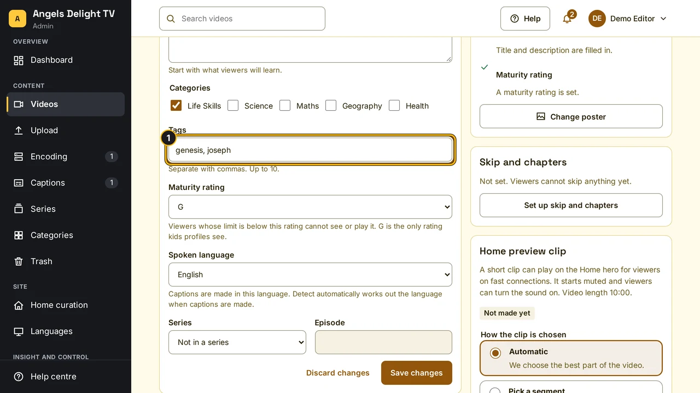

## What you will do
Use categories for the big shelves and tags for subjects. You end with a video tagged so people can find it by search.

## Before you start
You need the Editor role or above. Read Manage categories.

A good plan: few categories (about six), many tags. Put a Genesis lesson in the category Bible Teaching and add tags like genesis, noah, creation. A series bundles videos in order; a category groups videos by shelf; a tag helps search.

## Steps
<!-- kb:steps W29 -->
1. Choose **Videos** in the side menu.
2. Type "Joseph" in the **Search** box.
3. Click **Edit Demo lesson: Joseph is sold**.
4. Type "genesis, joseph" in the **Tags** box.
   
5. Click **Save changes**.
<!-- /kb:steps -->

## What you should see
A message says the video was saved. The tags show in the **Tags** box, separated by commas.

> [!TIP]
> Use lower case tags and the same spelling every time, so search finds all of them.

## If something goes wrong
- **The tags do not save.** Check for a very long tag. Keep each tag short.
- **A video shows in the wrong shelf.** Change its category in the same editor. Add the title, description and categories
