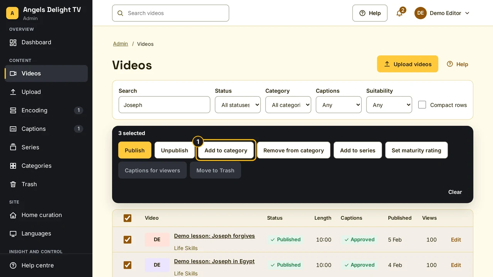

## What you will do
Change several videos together with the bulk bar. You end with the chosen videos in a new category, the same way you can publish them or set their maturity rating.

## Before you start
You need the Editor role or above. The bar works on the rows ticked on the current page. Publish and Move to Trash need the matching role.

The bar offers **Publish**, **Unpublish**, **Add to category**, **Remove from category**, **Add to series**, **Set maturity rating** and **Move to Trash**. Publish asks you to confirm first. The others open a small box with a list and an **Apply** button.

## Steps
<!-- kb:steps W30 -->
1. Choose **Videos** in the side menu.
2. Type "Joseph" in the **Search** box.
3. Wait until you see **Demo lesson: Joseph is sold** in the list.
4. Tick **Select all on this page**.
   
5. Click **Add to category** in the bar.
6. Select **Life Skills** from the **Category** list.
7. Click **Apply** in the box.
<!-- /kb:steps -->

## What you should see
A message says how many videos changed, with **Undo** for a few seconds. The list shows the new category.

> [!TIP]
> Use **Set maturity rating** to set the suitability of many videos together.

## If something goes wrong
- **A bar button is grey.** Your role cannot do it, or you used Select all for every match. Select rows on this page instead.
- **Some videos failed.** The result lists each one with a reason. Click Retry on the result.
