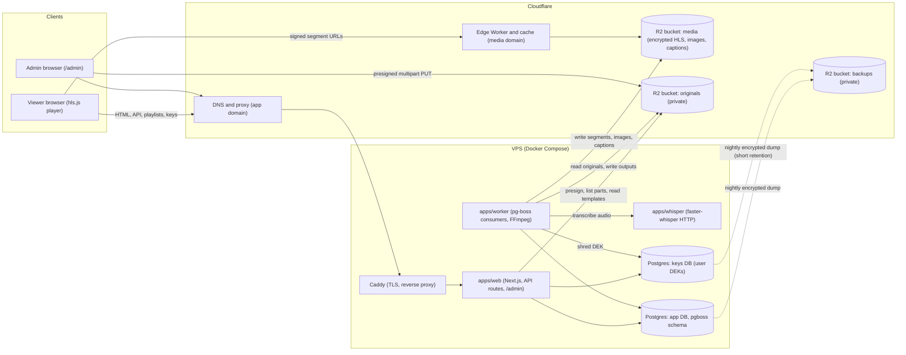
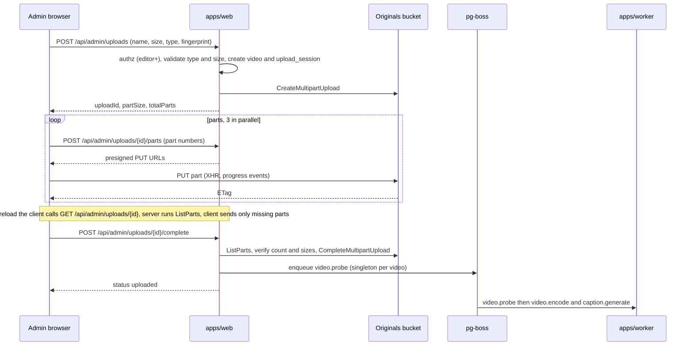
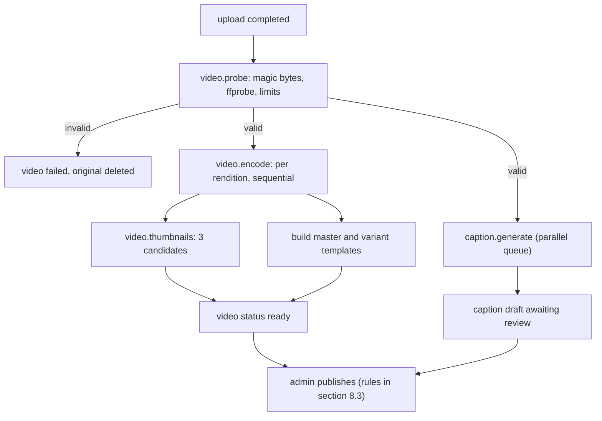
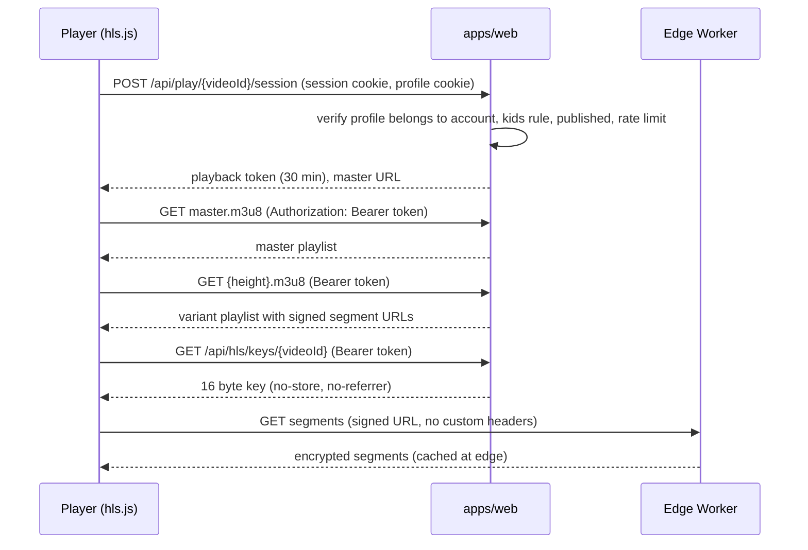

# Architecture

Status: design stage. No application code exists yet. Script names, package names and paths below are the contract the scaffold must implement. Update this file in the same session as any change that contradicts it.

Sources: `docs/PROJECT-BRIEF.md` (source of truth), `docs/SECURITY.md`, `docs/DATA-MODEL.md`, `docs/DEPLOYMENT.md`. Decisions that needed the owner are logged in `docs/DECISIONS.md`.

## 1. Drivers and constraints

| Driver | Consequence |
|---|---|
| Free platform, about 100 videos, 13 hours total | Single VPS is enough. Video bytes never touch the VPS at playback time. |
| Nigeria first: low-end Android, expensive and patchy data | Small first segments, conservative starting bitrate, 360p rung, resumable uploads, no heavy client JS on public pages, pre-sized thumbnails. |
| Running cost target about 12 to 17 USD per month | No Redis, no managed queue, no paid DRM, R2 for zero egress, Cloudflare free plan. |
| Not on YouTube | Own encode, caption and delivery pipeline. |
| Client input pending (name, domain, colours, logo, languages) | Everything client-facing is configuration: `settings`, `theme_settings`, env. Nothing hardcoded. |
| Children may watch | Kids profiles, kids-safe flag enforced server side, minimal data. See SECURITY.md section 12. |
| Built with AI assistance | Simple structure, no speculative abstractions, no swallowed errors (`docs/AI-CODE-FOOTPRINT.md`). |

## 2. System diagram



Component responsibilities:

| Component | Responsibility | Never does |
|---|---|---|
| Cloudflare DNS and proxy | TLS to browser, DDoS absorption, coarse rate limits for the app domain | Proxy video bytes from the VPS |
| Edge Worker (`apps/edge`) | Verifies signed segment URLs, serves R2 objects with immutable caching | Run business logic or touch the database |
| `apps/web` | UI, API, auth, authorization, playlists, key endpoint, upload orchestration, admin | Run FFmpeg, receive video bytes, write to the media bucket |
| `apps/worker` | Probe, encode, thumbnails, captions, image processing, cleanup, stats rollup, DEK shredding | Read account, profile or session tables, send email |
| `apps/whisper` | Speech to text and optional script alignment over HTTP | Access the database or storage credentials |
| Postgres | System of record, job queue (pg-boss), rate limit buckets, RLS | Store video bytes |
| Keys DB | Wrapped per-user data keys for crypto-shredding | Share credentials with the app DB |

## 3. Stack decisions

| Area | Decision | Reasons | Rejected |
|---|---|---|---|
| Web framework | Next.js App Router, one app for site and `/admin` | Brief mandates it. One deploy unit, server components keep client JS small on low-end phones, route handlers cover the API. | Separate SPA plus API: two deploys for no gain. |
| Language | TypeScript strict. `strict`, `noUncheckedIndexedAccess`, `exactOptionalPropertyTypes`, `noImplicitOverride`, `verbatimModuleSyntax` | Catches null and index bugs at compile time, so fewer defensive checks are needed at runtime. | Loose TS. |
| Runtime | Node.js current LTS (24 at time of writing), pinned in `.nvmrc` and Docker | Stable, matches worker and web. | Bun and Deno: less proven with FFmpeg child processes and native modules. |
| Package manager | pnpm workspaces | Fast, strict dependency isolation, lifecycle scripts of dependencies off by default (`onlyBuiltDependencies` allowlist), supports `minimumReleaseAge`. | npm, yarn. |
| Database | Postgres 17 | One store for data, queue, rate limits, full text search, RLS. Fits a single VPS. | MySQL, SQLite (no RLS, weaker concurrency), a separate search engine (overkill for 100 titles). |
| ORM | Drizzle ORM with drizzle-kit migrations. RLS policies and triggers in hand-written SQL migrations | SQL-shaped, light, typed, no runtime codegen. Explicit field whitelists suit the mass-assignment rule. | Prisma: heavier engine, weaker RLS and raw SQL ergonomics. |
| Authentication | Custom database-backed opaque sessions (recommended over Auth.js). See 3.1 | Needs profiles above accounts, encrypted email for crypto-shredding, role-based session lifetimes, instant revocation. | Auth.js, Better Auth. |
| Password hashing | argon2id via `@node-rs/argon2` | Current OWASP recommendation, prebuilt binaries, no node-gyp on the VPS. | bcrypt, scrypt. |
| Validation | Zod (v4) at every trust boundary, `.strict()` objects | One schema gives type, runtime check and form errors. Rejects unknown keys (mass assignment). | Hand validation. |
| Rate limiting | Postgres-backed token bucket in an UNLOGGED table, plus Cloudflare rules at the edge | Avoids Redis. Atomic single-statement upsert. Load is tiny. | Redis (extra service to run, patch and back up). In-memory (breaks on restart and across containers). |
| Job queue | pg-boss | Runs on the same Postgres, supports retries, expiry, singleton keys, cron, no Redis. | BullMQ (needs Redis). |
| Video processing | FFmpeg in the worker image, CPU x264 | Reliable, scriptable, no GPU on the VPS. | Cloud transcoding (cost). |
| Captions | faster-whisper in its own container, CPU int8 | Good English accuracy on clean narration, isolated heavy dependency (Python, model files). | Calling a paid API (cost, data leaves the platform). |
| Object storage | S3-compatible client (`@aws-sdk/client-s3` and presigner), R2 in production, MinIO (or compatible) in dev | One S3 driver covers both. Multipart presigning is first class. | Vendor SDK for R2 only. |
| Player | hls.js (the pinned build shipped with Video.js v10) behind our own `PlayerEngine` interface, custom controls (D-042) | Token, key loader and recovery rules need direct engine control. | Video.js v10 skin, Vidstack, Plyr, native `<video>` only (no Android HLS). |
| Images | `sharp` in the worker | Re-encodes uploads, strips metadata, builds fixed sizes. | Next image optimizer on the VPS (CPU cost). |
| Email | SMTP through `nodemailer`, provider-agnostic (for example Brevo), Mailpit in dev | No lock-in. Needs SPF, DKIM and DMARC on the sending domain. | Provider SDK. |
| Reverse proxy | Caddy | Small config, HTTP/2 and HTTP/3, easy headers. | Nginx, Traefik. |
| Tests | Vitest (unit and integration), Playwright (e2e) | See TESTING.md. | Jest. |
| Logging | pino JSON with redaction | Structured, fast, cheap. | console. |

### 3.1 Auth recommendation: custom sessions

Built as `packages/auth` (sessions, passwords, field encryption keys) with the web gateway in `apps/web/src/server/auth`, following the OWASP session management guidance.

Why not Auth.js: (1) its user model expects a plain email column, which conflicts with encrypted email plus HMAC lookup hash needed for crypto-shredding; (2) the credentials provider is built around JWT sessions, while we need server-side revocation and per-role lifetimes; (3) the profile layer (Netflix style, kids profiles) sits between account and content and is not modelled by it; (4) no social login is needed at launch.

Risks accepted: hand-written auth has more bug surface. Mitigations: tiny surface (signup, verify, login, logout, reset, change password, MFA for staff), tests first for every rule, the independent scan pass described in SECURITY.md section 17, and no cleverness (opaque random token, SHA-256 hash in the database, no signed cookies carrying claims). If social login is ever required, add OAuth clients (for example `arctic`) beside this module rather than replacing it. Reversible: yes, at moderate cost.

## 4. Monorepo layout

```
angels-delight-tv/
  apps/
    web/            Next.js app (site, /admin, API routes)
    worker/         pg-boss consumers, FFmpeg, sharp
    whisper/        Python service (faster-whisper). Not a pnpm package
    edge/           Cloudflare Worker for signed segment URLs (wrangler project)
  packages/
    db/             Drizzle schema, SQL migrations, withAccount, test database helpers (@ad/db/testing)
    storage/        StorageAdapter interface, s3 driver, local driver, multipart helpers, driver contract suite
    config/         Zod env loaders (web, worker, migrate)
    shared/         Ids, typed errors, crypto helpers, logger, DATA-MODEL enums
    ui/             tokens.css, the theme variable helper and the component library
    auth/           Argon2id passwords, sessions, field keys, sign up and sign in, staff TOTP, invites, first admin seed
    security/       Rate limiter, lockouts, CSRF, CSP, client address handling
    mailer/         SMTP transport and email templates
    audit/          Append only audit writer and reader
    analytics/      Event collection, daily rollups, admin analytics reads
    queue/          pg-boss client factory and typed job contracts
    video/          Upload sessions, encoding pipeline, captions, playback authorization, lifecycle
    catalog/        Titles, series, categories, home curation, search, publishing, admin catalog services
    viewer/         Profiles, kids mode, Continue Watching, My List, progress
    player/         Player controller, hls.js and native engines, React view
    theme/          Theme and site settings, logo handling, legal pages
  docs/
  docker/           postgres init scripts, minio init script, caddy config
  scripts/          footprint check, hook installer, sample HLS and e2e helpers. deploy and backup scripts come later
  docker-compose.yml      local dev
  compose.prod.yaml       production (not yet created)
  tsconfig.base.json  eslint.config.js  vitest.config.ts  pnpm-workspace.yaml
```

Rules:
- Package names use the `@ad/` scope (`@ad/web`, `@ad/db`, ...).
- `apps/*` may import `packages/*`. Packages never import apps. `apps/web` and `apps/worker` never import each other.
- Only `packages/db` exports table definitions. `apps/web` route files may not import them directly. They call repository functions under `apps/web/src/server/**`, enforced by an ESLint `no-restricted-imports` rule.
- A package exists only when two consumers exist or a boundary needs enforcing. `packages/ui` was added in lane A so the tokens and theme helper have one home that web and tests share. Basic hashing, HMAC and AES-GCM helpers live in `packages/shared` until lane B creates `packages/crypto` around them (D-014).
- Workspace packages ship TypeScript source (`exports` point at `src`). Next compiles them through `transpilePackages`, the worker runs through `tsx`, so there is no package build step.
- `apps/web` inner layout: `src/app` (routes), `src/server` (auth, repositories, services, policies), `src/features` (client components by feature: player, upload, theme editor), `src/lib` (small shared helpers).

## 5. Request pipeline in `apps/web`

Every request that changes or reads user data goes through the same ordered steps:

1. Interceptor (Next middleware, named proxy in newer majors): attaches request id, CSP nonce and security headers, applies coarse rate limit. It never makes the final authorization decision (see CVE-2025-29927, middleware bypass).
2. Route handler or server action: `assertSameOrigin()` for state-changing requests.
3. Parse and validate input with Zod (`.strict()`).
4. `requireSession()` returns the actor (account id, role, mfa state) or throws 401.
5. Authorization policy function, for example `canViewVideo(actor, profile, video)`. Profile ownership check comes first.
6. Service function runs inside `withAccount(accountId, role, fn)`, which opens a transaction and sets `app.account_id` and `app.actor_role` (transaction scoped) so Postgres RLS applies.
7. Response DTO built by an explicit mapper. Never return a table row object.
8. Audit entry for the actions listed in SECURITY.md section 15.

Errors: typed `AppError` subclasses (`NotFound`, `Forbidden`, `Conflict`, `RateLimited`, `ValidationFailed`) map to status codes in one place. Unknown errors become 500, are logged with the request id, and are reported to Sentry if enabled. No catch block may return a success-shaped value.

## 6. Storage layout and adapter

Three buckets (names configurable):

| Bucket | Access | Contents |
|---|---|---|
| `originals` | Private. Presigned URLs only. Never has a public domain. | `originals/{videoId}/{uploadId}` source files, `templates/{videoId}/...` playlist templates, `captions-draft/...`, `images-raw/...` |
| `media` | Served only through the media domain (Edge Worker). | `v/{mediaPrefix}/{height}/seg_00001.ts`, `img/{assetId}/{width}-{sha8}.webp`, `cap/{mediaPrefix}/{lang}/{sha8}.vtt` |
| `backups` | Private, separate token. | Encrypted database dumps. |

`mediaPrefix` is 128 random bits, base32. Unguessable paths are defense in depth, not the control.

### 6.1 Adapter

```ts
// packages/storage
export interface StorageAdapter {
  put(key: string, body: Uint8Array | Readable, opts: PutOptions): Promise<void>;
  get(key: string): Promise<Readable>;
  head(key: string): Promise<ObjectInfo | null>;
  delete(key: string): Promise<void>;
  deletePrefix(prefix: string): Promise<number>;
  list(prefix: string): Promise<ObjectInfo[]>;
  presignGet(key: string, ttlSeconds: number): Promise<string>;
  createMultipart(key: string, opts: PutOptions): Promise<{ uploadId: string }>;
  presignPart(key: string, uploadId: string, partNumber: number, sizeBytes: number, ttlSeconds: number): Promise<string>;
  listParts(key: string, uploadId: string): Promise<PartInfo[]>;
  completeMultipart(key: string, uploadId: string, parts: PartInfo[]): Promise<void>;
  abortMultipart(key: string, uploadId: string): Promise<void>;
}
```

Factory: `createStorage({ driver, bucket })`, called twice per process for `originals` and `media`.

| Driver | Use | Notes |
|---|---|---|
| `s3` | Production (R2) and dev (MinIO or compatible) | Path-style flag for MinIO. Same code path as production, so dev exercises the real multipart flow. |
| `local` | Unit and integration tests, zero-Docker fallback | Files under `LOCAL_STORAGE_ROOT`. `presignPart` returns an HMAC-signed app URL (`/api/dev-storage/...`) handled only when `STORAGE_DRIVER=local`. The route refuses to mount when `NODE_ENV=production`. |

Two real implementations exist, so the interface is justified. Work proceeds on MinIO first; R2 keys are only needed at staging time. Note: MinIO's community distribution has changed recently (reduced maintenance and image publishing). Pin a known-good image tag, and keep the driver vendor neutral so Garage or SeaweedFS can replace it.

## 7. Upload flow (admin, resumable, direct to storage)



Rules:
- Part size default 8 MiB (`UPLOAD_PART_BYTES`, D-006), all parts equal except the last. S3 limits: minimum 5 MiB, maximum 10,000 parts. `totalParts = ceil(size / partSize)`.
- Concurrency 3 parts per file, one lane per file, independent retries with exponential backoff and jitter. A failed file never blocks others (UI standard section 4).
- The browser reads the `ETag` response header. Bucket CORS must expose it.
- Server truth is `ListParts`, never the client's list. The client also keeps `{uploadId, fingerprint}` in IndexedDB so re-selecting the same file after a restart resumes. Fingerprint is a hash of name, size and last modified time, unique per creator while the session is open.
- Each part URL is signed for the exact `Content-Length` it will carry. At completion the server rejects totals that differ from the declared size and aborts the upload.
- Quarantine: nothing in `originals` is ever served. Magic bytes and `ffprobe` validation happen in `video.probe` (SECURITY.md section 8). Invalid files are deleted and the video is marked `failed` with a readable reason.
- Abort: `DELETE /api/admin/uploads/{id}` aborts the multipart upload. Cron `uploads.cleanup` aborts sessions idle for 48 hours. A bucket lifecycle rule aborts incomplete multipart uploads after 7 days as a backstop.
- Images (logo, hero, custom thumbnail) use the same flow with `kind=image` and a size cap of 10 MiB, then the `image.process` job.

Upload states: `initiated`, `uploading`, `completing`, `completed`, `aborted`, `expired`, `failed`.

## 8. Encoding flow



### 8.1 Ladder

Rungs at or below the source height only (never upscale). If the source is under 360p, a single rung at source height is produced.

| Rung | Resolution (16:9) | Video kbps (cap) | Audio kbps | H.264 profile |
|---|---|---|---|---|
| 360p | 640x360 | 500 | 96 | main |
| 480p | 854x480 | 900 | 96 | main |
| 720p | 1280x720 | 1800 | 128 | high |
| 1080p | 1920x1080 | 3500 | 128 | high |

Values are starting points to be tuned on real content in a spike. A 240p rung is a documented option if analytics show many viewers stuck at 360p.

### 8.2 FFmpeg settings (per rendition, one process each)

- Input: pass `-protocol_whitelist file` and only allow `ffprobe`-confirmed formats (mov or mp4, matroska or webm). Blocks crafted playlists that read local files or the network.
- Video: `libx264`, `-pix_fmt yuv420p`, CRF 23 with `-maxrate` and `-bufsize 2x` of the cap, `-preset` from `FFMPEG_PRESET` (default `medium`), `-sc_threshold 0`, `-force_key_frames "expr:gte(t,n_forced*6)"` so keyframes align across rungs.
- Audio: AAC-LC stereo, 44.1 or 48 kHz.
- HLS: `-f hls -hls_time 6 -hls_playlist_type vod -hls_segment_type mpegts` with MPEG-TS segments (widest compatibility, native iOS fallback) and `-hls_key_info_file` for AES-128. IV defaults to the media sequence number.
- Each rendition is a checkpoint: `renditions.status` goes `pending, encoding, ready`. A retried job skips ready rungs and overwrites partial output.
- Scratch dir `WORKER_SCRATCH_DIR/{jobId}`. Preflight: free space at least 3 times the original size, otherwise the job is deferred. Always removed in a `finally`.
- Master and variant playlists are built by `packages/video` from probed results (bandwidth, resolution, codecs string), not by FFmpeg.
- Stored templates reference segments relatively and the key as `URI="ad-key://{videoId}"`. The web app rewrites both at serve time, so changing the media domain never needs re-encoding.

### 8.3 Status and publish rules

`videos.status`: `uploading, uploaded, validating, encoding, ready, failed`. Publication is separate: `publish_state` is `draft, scheduled, published, unpublished`. Publish requires `status = ready`, all rendition rows `ready`, a poster, and (setting `features.require_approved_captions`, default true) an approved caption track for the video language. Scheduled publish is evaluated by comparing `publish_at` to `now()` in queries, so no cron is needed for visibility.

## 9. Captions flow

1. `caption.generate` extracts mono 16 kHz audio with FFmpeg, stores it in `originals`, and calls `apps/whisper` with a presigned GET URL. Whisper never gets storage credentials.
2. Default model `small.en` with `int8` on CPU (`WHISPER_MODEL`, `WHISPER_COMPUTE_TYPE`). Service concurrency is 1. The worker call has a long timeout (default 20 minutes) and the job `expireInSeconds` is larger.
3. If the admin attached a script (plain text), mode `align` is used instead: word timestamps are produced and forced to match the script text with an alignment library (candidate: stable-ts, confirm in a spike). Script text is never trusted as markup.
4. Output is a WebVTT draft stored as a `captions` revision (`status = draft`, `source = whisper` or `aligned`). Admin reviews in the caption editor, edits (saves a new revision) and approves. Approval copies the file to `media/cap/...` with a content hash name and sets `caption_tracks.approved_caption_id`.
5. Only approved tracks are exposed to viewers. Phase 2 translations (NLLB-200 or a paid service) reuse the same tables with `source = translation`, one track per language, each reviewed separately. Whisper quality for Yoruba, Igbo and Hausa is weak, so those languages should be script-aligned or human-transcribed.

## 10. HLS encryption and signed URL flow

Two layers, with different jobs:

| Layer | What it protects | Mechanism |
|---|---|---|
| AES-128 segment encryption | The content itself. The real gate. | One random 16 byte key per video, stored wrapped (AES-256-GCM with `HLS_KEK`, AAD = video id) in `video_keys`. The key is served only by `GET /api/hls/keys/{videoId}` after token and published checks. |
| Signed segment URLs | Hotlinking and bulk scraping of ciphertext from the CDN | HMAC of path and expiry, verified by the Edge Worker (`EDGE_TOKEN_MODE=worker`). |

This is not DRM. A determined logged-in viewer can capture the stream. The design stops casual downloading, hotlinking and anonymous access, which matches the brief.

Playlists are served by the app, not the CDN:
- `GET /api/play/{videoId}/master.m3u8` returns the master playlist with variant URIs pointing to `/api/play/{videoId}/{height}.m3u8`.
- The variant endpoint reads the stored template from `originals`, rewrites each segment URI to `https://{MEDIA_HOST}/v/{prefix}/{height}/seg_N.ts?exp={unix}&sig={hmac}` and the key URI to `https://{APP_HOST}/api/hls/keys/{videoId}`.
- Playlists are `Cache-Control: private, no-store`. They are a few KB, so serving them from the VPS is cheap and does not proxy video.
- Segment signature: `sig = base64url(HMAC_SHA256(MEDIA_URL_SECRET, path + "\n" + exp))`, `exp` equals now plus 2 hours for an account and 20 minutes for a guest (`limits.guest_segment_minutes`, 5 to 120). Clock skew allowance 30 seconds. The Edge Worker does not know which kind of viewer asked: it checks signature and expiry only.

Edge Worker behaviour: verify signature and expiry, else 403. Strip `exp` and `sig` for the cache key. Serve from the Worker cache or R2 binding (honour `Range`), with `Cache-Control: public, max-age=31536000, immutable`, `X-Content-Type-Options: nosniff`, and CORS for the app origin only. Free plan Workers allow 100,000 requests per day, roughly 1,200 plays per day at 80 segments each, so budget for the 5 USD paid plan before that volume. `EDGE_TOKEN_MODE=off` is for dev and temporary rollback only.

## 11. Playback token flow



- Token format: `v1.{kid}.{payload}.{mac}`, payload is base64url JSON `{vid, pid, aid, iat, exp, n}` plus, for a visitor with no account, `gst` (true) and `kd` (Kids mode, true or absent). For a guest `aid` holds the random guest id and `pid` is empty. A token never carries both `gst` and `pv` (staff preview), and the verifier refuses one that does. The key route reads `kd` and answers 404 for a video that is not Kids safe, without a profile lookup, MAC is HMAC-SHA256 with `PLAYBACK_TOKEN_SECRET`. `kid` allows rotation with two active secrets.
- Stateless verification, plus one primary key lookup that the video is still published. Logout does not revoke a token already issued. The 30 minute lifetime bounds that, and videos are at most 8 minutes. The client refreshes on a 401.
- The player adds `Authorization` only for requests to the app origin (hls.js `xhrSetup`). Requests to the media domain carry no custom headers, so the CDN sees no CORS preflight.
- Fallback for native HLS (cannot set headers): token in `?pt=` on playlist and key routes only. Caddy and the app redact that parameter from logs and the routes send `Referrer-Policy: no-referrer`. Documented risk R-3 in SECURITY.md.
- Rate limits: session mint 60 per minute per profile, key route 20 per 10 minutes per profile plus 300 per minute per IP. Guest session mint 20 per minute per guest id and 120 per minute per network. After 3 refusals from one network in 10 minutes a new guest session answers 403 `challenge_required` until a Turnstile token arrives in `x-turnstile-token` (only when Turnstile is configured).
- Guest sessions (M40): with no account session and `features.guest_play` on, `POST /api/play/{videoId}/session` checks the same origin first, then reads or mints the guest cookie `__Host-ad_guest` (the only place it is set), applies the Kids mode choice of the device and returns the same response shape. The guest cookie is never a session: personal routes stay 401 with it. The edge, the key route and the playlists work as for accounts.

Player tuning for the audience: `preload="metadata"`, start on 360p or 480p, conservative initial bandwidth estimate (about 500 kbps), `capLevelToPlayerSize`, a data saver toggle capping at 480p, progress saved every 15 seconds, on pause, on `visibilitychange` and with `sendBeacon` on page hide.

## 12. CDN caching rules

| Path or asset | Origin Cache-Control | Edge | Browser | Notes |
|---|---|---|---|---|
| `v/*/*.ts` segments | `public, max-age=31536000, immutable` | 1 year, cache key ignores query | 1 year | Content never changes at a path. Re-encode writes a new `mediaPrefix`. |
| `img/*` (hash named) | same | 1 year | 1 year | New upload equals new key. |
| `cap/*` (hash named) | same | 1 year | 1 year | New revision equals new key. |
| App HTML and API (app domain) | `private, no-store` for authenticated pages | Bypass | none | Landing page may use short public caching. Pages a guest sees are rendered per request from the device Kids mode cookie and are not edge cached: the same URL differs by that cookie. |
| `/_next/static/*` | `public, max-age=31536000, immutable` | 1 year | 1 year | Cloudflare proxied. |
| Playlists, key route | `private, no-store` | Bypass | none | Dynamic and per viewer. |

Cache rule on the media host: eligible for cache, ignore query string in the cache key. Do not enable Cache Reserve at launch.

## 13. Background jobs

pg-boss runs in the worker (consumer, maintenance and cron). `apps/web` creates a producer-only client (no supervision, no cron). Queues are created explicitly at worker start.

| Queue | Concurrency | Retries | Expire | Notes |
|---|---|---|---|---|
| `video.probe` | 2 | 3, backoff 30 s | 10 min | Singleton per video |
| `video.encode` | 1 | 3, backoff 2 min | 3 h | Checkpoint per rendition |
| `video.thumbnails` | 2 | 3 | 15 min | 3 candidates at 10, 50, 90 percent |
| `caption.generate` | 1 | 2 | 45 min | Calls whisper |
| `image.process` | 2 | 3 | 5 min | sharp, strip metadata, fixed widths |
| `video.rekey` | 1 | 2 | 3 h | Re-encrypt segments with a new key, no transcode |
| `video.purge` | 1 | 3 | 30 min | Deletes storage prefixes of soft-deleted videos |
| `accounts.shred` | 2 | 10, backoff 10 min | 5 min | Idempotent DEK destruction, payload is the account UUID only |

Cron (timezone `Africa/Lagos`): `uploads.cleanup` hourly, `rate_limits.cleanup` hourly, `sessions.cleanup` daily, `email_tokens.cleanup` daily, `stats.rollup` 02:00, `videos.purge_deleted` daily (30 day grace), `view_events.prune` monthly.

Design rules:
- Payloads carry ids only, never PII, secrets or tokens. Completed job retention is short.
- Every handler is idempotent (deterministic output keys, upserts, `ON CONFLICT`).
- Duplicate protection with pg-boss singleton keys plus the unique partial index on `jobs (kind, video_id)` for active jobs.
- The `jobs` table mirrors state for the admin UI (stage, progress 0 to 100, error). The worker writes it. pg-boss owns its own `pgboss` schema.
- Permanent errors (invalid media, unsupported codec) are recorded as `failed_permanent` with a readable code, reported, and the pg-boss job is failed with no retries left. Transient errors (network, 5xx, timeouts) throw and are retried. Verify the exact fail-without-retry call in the pinned pg-boss version during the first spike.
- Sign in and account email is not queued: the web process sends directly with a timeout and the user can resend (rate limited). This keeps addresses and raw tokens out of the queue. Staff notification and export email goes through `email_outbox` and the worker (`email.outbox` every minute, `email.digest` hourly), with sealed addresses, retry and provider message ids (D-129).

## 14. Failure handling

| Failure | Behaviour |
|---|---|
| Browser or network drops mid-upload | Resume from `ListParts`. Inline Retry per file. |
| R2 or MinIO 5xx or timeout | Client part retry with backoff. Worker retry. Job fails after the retry limit and shows a Retry button. |
| Worker killed mid-encode | Job expires, pg-boss retries, finished renditions are skipped. SIGTERM triggers graceful stop with a timeout, FFmpeg children are killed. |
| Corrupt or hostile upload | `video.probe` marks failed, deletes the object, audit entry written. |
| Disk full on worker | Preflight defers the job and raises an alert. Scratch is always cleaned in `finally`. |
| Whisper out of memory or crash | Caption job fails and retries. Video publishing is not blocked unless the require-captions setting is on. |
| Postgres down | `/api/ready` fails, Caddy returns 503, web serves a static maintenance page. Workers retry connections with backoff. |
| Key endpoint failing | Player retries 3 times with backoff, then shows a clear error and a Retry button. |
| Signed URL expired mid-session | Player requests a new variant playlist using the token, or a fresh token on 401. |
| Clock skew | Server clock only, 30 second leeway, NTP enforced on the VPS. |
| SMTP down | Signup succeeds, the user sees "resend email". Failure logged and reported. |
| Partial publish | Publish is a single transaction that checks all preconditions. |
| Migration failure | Deploy aborts before switching containers. See DEPLOYMENT.md. |

Rule: no failure path returns a success-shaped result. A fallback must be a specific, logged decision.

## 15. Environment variables

Parsed with Zod at boot (`packages/config`: `loadWebEnv`, `loadWorkerEnv`, `loadMigrateEnv`), separate schemas per app, process exits on invalid config. `.env.example` lists names only. Secrets never go in `settings` or the repo.

| Variable | Apps | Secret | Purpose |
|---|---|---|---|
| `NODE_ENV` | all | no | `development`, `test`, `production` |
| `APP_ORIGIN` | web, worker | no | Canonical origin, for example `https://app.example.com` |
| `MEDIA_ORIGIN` | web, worker, edge | no | Media origin, for example `https://video.example.com` |
| `COOKIE_PREFIX_SECURE` | web | no | `true` in production (`__Host-` names) |
| `TRUSTED_PROXY_MODE` | web | no | `cloudflare` or `none`, controls `CF-Connecting-IP` trust |
| `DATABASE_URL` | web | yes | Runtime role `ad_app` |
| `DATABASE_URL_WORKER` | worker | yes | Runtime role `ad_worker` |
| `DATABASE_URL_MAINTENANCE` | worker | no | Runtime role `ad_maintenance`. Without it the view event prune and audit prune jobs are not registered |
| `DATABASE_URL_MIGRATE` | deploy only | yes | Owner role for migrations, never given to long-running containers |
| `KEYS_DATABASE_URL_MIGRATE` | deploy only | yes | Owner role for the keys database migrations. Optional |
| `KEYS_DATABASE_URL` | web | yes | Keys DB, role `ad_keys_app` |
| `KEYS_DATABASE_URL_SHRED` | worker | yes | Keys DB, delete-only role |
| `FIELD_KEK` | web | yes | 32 byte base64 key wrapping user DEKs. `FIELD_KEK_PREVIOUS` optional during rotation |
| `EMAIL_HASH_PEPPER` | web | yes | HMAC pepper for email lookup hash |
| `HLS_KEK` | web, worker | yes | Wraps per-video HLS keys. `HLS_KEK_PREVIOUS` optional |
| `PLAYBACK_TOKEN_SECRET` | web | yes | HMAC for playback tokens. `PLAYBACK_TOKEN_SECRET_PREVIOUS` optional |
| `MEDIA_URL_SECRET` | web, edge | yes | HMAC for signed segment URLs |
| `EDGE_TOKEN_MODE` | web | no | `worker` or `off` |
| `STORAGE_DRIVER` | web, worker | no | `s3` or `local` |
| `S3_ENDPOINT` | web, worker | no | R2 account endpoint or MinIO URL |
| `S3_REGION` | web, worker | no | `auto` for R2 |
| `S3_FORCE_PATH_STYLE` | web, worker | no | `true` for MinIO |
| `S3_ACCESS_KEY_ID`, `S3_SECRET_ACCESS_KEY` | web, worker | yes | Per-app credentials (web: originals only, worker: originals and media) |
| `BUCKET_ORIGINALS`, `BUCKET_MEDIA` | web, worker | no | Bucket names |
| `LOCAL_STORAGE_ROOT` | web, worker | no | Local driver root |
| `MAX_UPLOAD_BYTES` | web | no | Default 5 GiB (D-006) |
| `MAX_VIDEO_SECONDS` | web, worker | no | Default 1800 |
| `UPLOAD_PART_BYTES` | web | no | Default 8 MiB (D-006), minimum 5 MiB |
| `SMTP_URL`, `EMAIL_FROM` | web | yes, no | SMTP connection, sender address |
| `TURNSTILE_SITE_KEY`, `TURNSTILE_SECRET_KEY` | web | no, yes | Optional bot check on signup and reset |
| `WHISPER_URL` | worker | no | Internal URL of the whisper service |
| `WHISPER_MODEL`, `WHISPER_COMPUTE_TYPE` | whisper | no | Default `small.en`, `int8` |
| `FFMPEG_PRESET`, `FFMPEG_THREADS` | worker | no | Encode tuning |
| `WORKER_SCRATCH_DIR` | worker | no | Local temp dir |
| `SENTRY_DSN` | web, worker | no | Optional |
| `LOG_LEVEL` | all | no | `info` default |

## 16. Scaling notes

- Playback load lands on Cloudflare and R2, not the VPS. The VPS sees page loads, playlists, keys and progress writes.
- Progress writes: one per active viewer every 15 seconds. 1,000 concurrent viewers is about 67 writes per second, fine for Postgres on a small VPS with `watch_progress` upserts.
- Database pools: web max 10, worker max 4. Add PgBouncer only if connection counts become a problem.
- First bottleneck will be encode CPU during bulk upload of the launch library. Mitigate with a queue (concurrency 1), `nice`, container CPU limits, and scheduling bulk uploads off-peak.
- Next steps in order: bigger VPS, move the worker and whisper to a second VPS (same Postgres over a private network or TLS), managed Postgres, then a Redis cache only if measured need.
- Watch edge cache hit ratio and Worker request counts as the first cost signals.
- Live streaming is out of scope. If added later it needs its own ingest design.

## 17. Observability

pino logs with request id, route, status and duration, with redaction of cookies, authorization headers, tokens and emails. Container logs rotate (`max-size`, `max-file`). Health: `/api/health` (process) and `/api/ready` (database). Admin dashboard shows queue depth, failed jobs and last encode durations. Optional Sentry (or self-hosted GlitchTip) per DEPLOYMENT.md. Self-healing PR workflow is advisory only: fixes are applied on a branch and committed as ARKDEV (see TDD-PROTOCOL.md).

## 18. Configurable, never hardcoded

Platform name, tagline, logo, favicon, colours, fonts, sizes, domain, home rows, languages, legal text versions, signup open or closed, caption requirement, profile limit. These live in `settings` and `theme_settings` (stored as CSS variables, validated against an allowlist). Visual defaults come from the brief and are only the seed for the first published theme.

## 19. Decision summary

1. Custom session auth, not Auth.js.
2. Postgres token bucket for rate limits, no Redis.
3. pg-boss for jobs.
4. One S3 driver for R2 and MinIO, plus a local driver for tests.
5. MPEG-TS, 6 second segments, AES-128 with one key per video.
6. Playlists served by the app, segments by an Edge Worker with signed URLs.
7. Whisper as a separate HTTP service, synchronous call, concurrency 1.
8. Web has no write access to the media bucket. Worker has no access to account data.
9. Email sent by the web process, not queued.
10. No Next image optimizer, pre-sized images from the worker.
